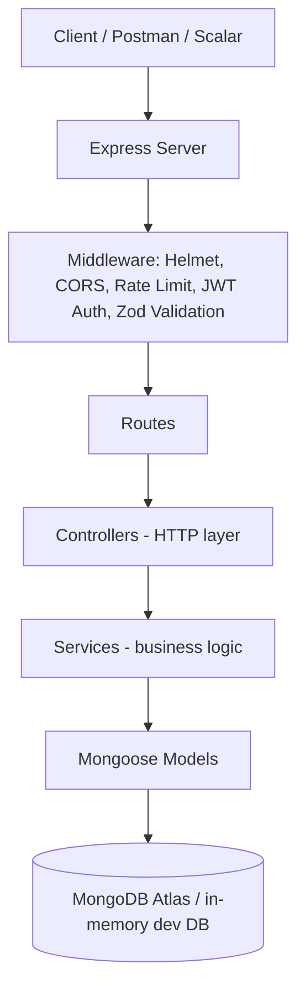
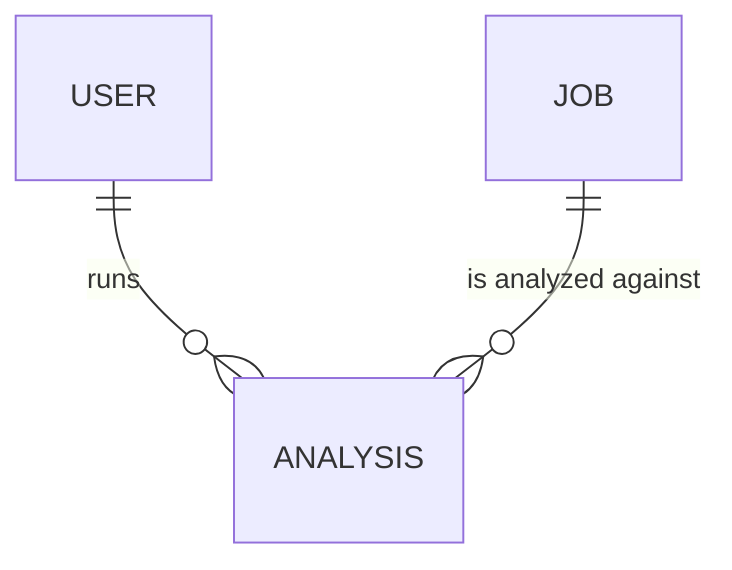
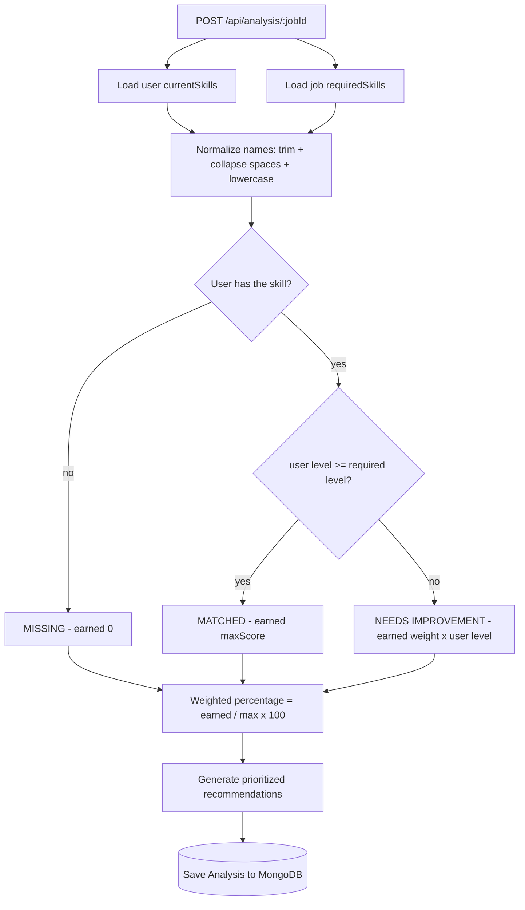

# SkillBridge AI — Career Skill Gap Analyzer

A backend-powered career guidance platform that compares a user's current skills with the requirements of a target job and returns matched skills, missing skills, skills that need improvement, a weighted overall match percentage, and prioritized learning recommendations.

Built as a **Phase 02 (From Idea to Demo)** backend prototype: a working, testable Express + MongoDB API — not a commercial platform.

---

## 1. Project Overview

| | |
|---|---|
| **Project** | SkillBridge AI — Career Skill Gap Analyzer |
| **Type** | Backend prototype (REST API, modular monolith) |
| **Runtime** | Node.js (>= 18) with CommonJS |
| **Database** | MongoDB Atlas (or any MongoDB URI) |
| **Docs** | OpenAPI 3.0 at `/openapi.json`, Scalar UI at `/api-reference` |

## 2. Problem Statement

Many university graduates have academic qualifications but lack the practical, industry-relevant skills employers expect. Students usually do **not** know:

- which skills their target job actually requires,
- which of those they already possess,
- which they are missing entirely,
- which ones they have but at a level below the requirement,
- what to learn **next** and in which order.

## 3. Proposed Solution

SkillBridge AI lets a user register, fill in a skill profile, pick a target job, and run a **deterministic skill-gap analysis**. The engine (no external AI service involved) computes a weighted match score and produces a prioritized, personalized learning recommendation list. Because the logic is deterministic, the same input always produces the same, testable output.

An optional **AI Career Coach layer** can then explain a saved analysis in natural language and produce a week-by-week learning roadmap — powered by any free-tier OpenAI-compatible provider, with a built-in rule-based fallback when no AI key is configured.

## 4. Main Features

- JWT authentication (register / login / current user) with bcrypt-hashed passwords.
- User profile with a validated skill list (duplicates rejected, case/space-insensitive).
- Job catalog with 5 seeded sample roles, filterable by category and experience level.
- **Skill-gap analysis engine**: matched / missing / improvement categorization + weighted percentage.
- **Recommendation engine**: deterministic, importance-based priorities with practical suggestions.
- **AI Career Coach (optional, free-tier)**: natural-language explanation + week-by-week roadmap for a saved analysis, via any OpenAI-compatible provider; built-in rule-based fallback when AI is disabled or unavailable.
- Analysis history per user, with strict ownership checks (403 on cross-user access).
- Consistent JSON response envelope, central error handling, validation via Zod.
- Security: Helmet, CORS, rate limiting, JWT-protected routes, no stack traces in production.
- OpenAPI 3.0 specification + Scalar API reference.
- Automated test suite (Jest + Supertest) against an isolated in-memory MongoDB.

## 5. Technology Stack

| Area | Technology |
|---|---|
| Runtime | Node.js (CommonJS) |
| Backend framework | Express.js |
| Language | JavaScript (ES6+) |
| Database | MongoDB Atlas |
| ODM | Mongoose |
| Authentication | JWT (`jsonwebtoken`) |
| Password hashing | bcryptjs |
| Validation | Zod |
| Security | Helmet, cors, express-rate-limit |
| Environment variables | dotenv |
| API testing | Postman / Thunder Client |
| Automated testing | Jest + Supertest (+ mongodb-memory-server) |
| AI layer (optional) | Any OpenAI-compatible API via native `fetch` (Google AI Studio / Groq free tiers) |
| API documentation | Scalar (`@scalar/express-api-reference`) |
| API specification | OpenAPI 3.0 |
| Version control | Git & GitHub |

## 6. Backend Architecture



| Layer | Responsibility |
|---|---|
| Routes | Define endpoints, attach middleware |
| Controllers | Read the request, call a service, send the response |
| Services | All business logic (auth, analysis engine, recommendations) |
| Models | Mongoose schemas + data validation hooks |
| Middleware | Authentication, validation, rate limiting, central error handling |
| Validators | Zod schemas per request type |
| Utils | `ApiError`, `ApiResponse`, `asyncHandler` |

## 7. Database Design



**Users** — `name`, `email` (unique, lowercase), `password` (bcrypt hash, `select: false`), `education`, `university`, `currentSkills[] { skillName, proficiencyLevel }`, `careerGoal`, `experienceLevel`, timestamps.

**Jobs** — `title`, `company`, `description`, `category`, `experienceLevel`, `requiredSkills[] { skillName, requiredLevel, importance }`, `isActive`, timestamps. Seeded with 5 sample roles (demonstration profiles, not live vacancies).

**Analyses** — `user -> User`, `job -> Job`, `overallMatchPercentage`, `matchedSkills[]`, `missingSkills[]`, `improvementSkills[]`, `recommendations[]`, timestamps.

Allowed levels everywhere: `beginner | intermediate | advanced`. Allowed importance: `low | medium | high`.

## 8. Folder Structure

```
skillbridge-ai/
├── src/
│   ├── config/database.js          # Mongo connection (+ in-memory dev fallback)
│   ├── controllers/                # HTTP layer (auth, user, job, analysis, recommendation, ai)
│   ├── middleware/                 # auth, validate, error, not-found, rateLimit
│   ├── models/                     # User.js, Job.js, Analysis.js
│   ├── routes/                     # endpoint definitions
│   ├── services/                   # business logic incl. analysis + recommendation engines + AI coach
│   ├── validators/                 # Zod schemas
│   ├── utils/                      # ApiError, ApiResponse, asyncHandler
│   ├── seed/seedJobs.js            # idempotent sample-job seeding
│   ├── docs/openapi.js             # OpenAPI 3.0 specification
│   ├── app.js                      # Express app (exported, not listening)
│   └── server.js                   # entry point: env check -> DB -> listen
├── tests/                          # Jest + Supertest suites (auth, jobs, analysis, ai)
├── .env                            # local secrets (gitignored)
├── .env.example
├── .gitignore
├── jest.config.js
├── babel.config.js                 # only used by Jest (Scalar package is ESM-only)
├── package.json
├── README.md
├── WALKTHROUGH.md                  # 3-5 minute demo video plan
└── docs/SkillBridge-AI.postman_collection.json
```

## 9. Installation

Prerequisites: **Node.js >= 18** and npm.

```bash
git clone <your-repo-url>
cd skillbridge-ai
npm install
```

## 10. Environment Variable Setup

```bash
cp .env.example .env
```

| Variable | Required | Description |
|---|---|---|
| `PORT` | yes | HTTP port (default 3000) |
| `MONGODB_URI` | yes for persistence | MongoDB Atlas connection string. If **empty in development**, the app uses a temporary in-memory MongoDB (data resets on restart — handy for a quick demo, not for real use). Required in production. |
| `JWT_SECRET` | yes | Long random string — generate one with `openssl rand -hex 32` |
| `JWT_EXPIRES_IN` | yes | Token lifetime (default `1d`) |
| `NODE_ENV` | yes | `development` / `production` / `test` |
| `AI_ENABLED` | no | `true` turns on the AI Career Coach layer (default `false` → rule-based coach) |
| `AI_API_KEY` | no | API key of an OpenAI-compatible provider (Google AI Studio / Groq — both free) |
| `AI_BASE_URL` | no | e.g. `https://generativelanguage.googleapis.com/v1beta/openai/` (Google) or `https://api.groq.com/openai/v1` (Groq) |
| `AI_MODEL` | no | e.g. `gemini-3.8-flash` (Google) or `llama-3.1-8b-instant` (Groq) |

For MongoDB Atlas: create a free cluster, get the connection string (`mongodb+srv://...`), and whitelist your IP under **Network Access**. Put the URI in `MONGODB_URI`. Never commit the real `.env`.

## 11. Run the Server

```bash
npm run dev     # development (auto-restarts with nodemon)
npm start       # plain node
```

Expected startup output:

```
[OK] MongoDB connected -> ...
----------------------------------------------------------------
  SkillBridge AI API is running
  Local URL:  http://localhost:3000
  Health:     http://localhost:3000/api/health
  API docs:   http://localhost:3000/api-reference
  OpenAPI:    http://localhost:3000/openapi.json
----------------------------------------------------------------
```

## 12. Seed Sample Jobs

```bash
npm run seed
```

- Inserts the 5 sample job roles; **idempotent** — matched by title + company, so re-running updates instead of duplicating.
- Prints `[OK] Created` / `[OK] Updated` lines and a summary.
- If `MONGODB_URI` is empty, it warns that the data went into a temporary in-memory database.

## 13. API Endpoint List

| Method | Endpoint | Auth | Purpose |
|---|---|---|---|
| GET | `/api/health` | - | Server + database status |
| POST | `/api/auth/register` | - | Register (returns user + JWT) |
| POST | `/api/auth/login` | - | Log in (returns user + JWT) |
| GET | `/api/auth/me` | JWT | Current authenticated user |
| GET | `/api/users/profile` | JWT | Own profile |
| PUT | `/api/users/profile` | JWT | Update profile + skills (partial update) |
| GET | `/api/jobs` | - | Active jobs; optional `?category=&experienceLevel=` |
| GET | `/api/jobs/:id` | - | One job |
| POST | `/api/analysis/:jobId` | JWT | Run + save skill-gap analysis |
| GET | `/api/analysis/history` | JWT | Own analysis history (newest first) |
| GET | `/api/analysis/:id` | JWT | One analysis (owner only) |
| GET | `/api/recommendations/:analysisId` | JWT | Recommendations of an analysis (owner only) |
| POST | `/api/ai/explain/:analysisId` | JWT | Natural-language explanation of an analysis (owner only) |
| POST | `/api/ai/roadmap/:analysisId` | JWT | Week-by-week learning roadmap (owner only) |

Status codes: 200 success, 201 created, 400 validation, 401 unauthorized, 403 forbidden, 404 not found, 409 duplicate, 500 server error.

## 14. API Testing (Postman / Thunder Client)

1. Open Postman -> **Import** -> `docs/SkillBridge-AI.postman_collection.json`.
2. Start the server and seed the jobs (`npm run seed`).
3. Run the requests top to bottom. Collection variables (`token`, `jobId`, `analysisId`) are filled automatically by the request scripts.
4. The last folder contains deliberate error demos (401 / 403 / 404 / 400).

The same workflow works in Thunder Client (VS Code) with the same URLs and bodies.

## 15. Scalar Documentation

- UI: <http://localhost:3000/api-reference>
- Spec JSON: <http://localhost:3000/openapi.json>

To test protected endpoints inside Scalar: click **Authorize**, paste the JWT from login/register, then execute any protected request — Scalar attaches the `Authorization: Bearer` header automatically.

## 16. Example Skill-Gap Analysis Workflow

User profile: JavaScript (advanced), Node.js (beginner), MongoDB (intermediate), Git (intermediate), SQL (beginner).
Target job: **Junior Backend Developer** (requires JavaScript, Node.js, MongoDB, REST APIs, Git, SQL, Docker).

| Required skill | Level | Importance | User | Result | Max score | Earned |
|---|---|---|---|---|---:|---:|
| JavaScript | intermediate | high | advanced | Matched | 3x2 = 6 | 6 |
| Node.js | intermediate | high | beginner | Needs improvement | 6 | 3x1 = 3 |
| MongoDB | intermediate | high | intermediate | Matched | 6 | 6 |
| REST APIs | intermediate | high | - | Missing | 6 | 0 |
| Git | beginner | medium | intermediate | Matched | 2x1 = 2 | 2 |
| SQL | beginner | medium | beginner | Matched | 2 | 2 |
| Docker | beginner | low | - | Missing | 1x1 = 1 | 0 |
| **Total** | | | | | **29** | **19** |

`overallMatchPercentage = round(19 / 29 x 100, 2) = 65.52%`

Recommendations come out prioritized: REST APIs (high, missing) -> Node.js (high, improvement) -> Docker (low, missing).



## 17. AI Career Coach Layer (optional, free tier)

The AI layer is **additive and safe by design**:

- **The deterministic engine always computes the scores.** The AI never recalculates a percentage — it only receives the *saved* analysis JSON and turns it into human-friendly text, so a hallucinating model can never corrupt the data.
- **Graceful fallback:** if AI is disabled, not configured, slow (30 s timeout), or the provider fails, the endpoints still answer — using the built-in **rule-based coach** — and report `source: "rule-based"` instead of `"ai"`. The demo can never break.
- **Provider-agnostic, free-tier friendly:** any OpenAI-compatible API works via 3 env vars. No paid API is required — both options below have free tiers and need no credit card.

| Provider | Get a key | `AI_BASE_URL` | Example `AI_MODEL` |
|---|---|---|---|
| Google AI Studio (recommended) | <https://aistudio.google.com> | `https://generativelanguage.googleapis.com/v1beta/openai/` | `gemini-3.8-flash` |
| Groq | <https://console.groq.com> | `https://api.groq.com/openai/v1` | `llama-3.1-8b-instant` |

To enable: set `AI_ENABLED=true`, paste your `AI_API_KEY`, keep/adjust `AI_BASE_URL` + `AI_MODEL`, then restart the server. `POST /api/ai/explain/:analysisId` now returns LLM text with `source: "ai"`; every other scenario answers rule-based. Both endpoints enforce the same ownership rules as the analysis endpoints (401 / 400 / 403 / 404).

## 18. Testing

```bash
npm test
```

- 42 automated tests across 4 suites (`tests/auth.test.js`, `tests/jobs.test.js`, `tests/analysis.test.js`, `tests/ai.test.js`).
- Uses an **isolated in-memory MongoDB per run** — automated tests can never touch your Atlas data.
- Covers: registration, duplicate email, login, wrong password, token protection, job listing/filtering/details, the exact weighted-scoring example from the spec (80%), the 100% cap, jobs with no required skills, invalid/nonexistent IDs, analysis persistence, history, cross-user authorization (403), and the AI Coach endpoints (security surface, rule-based fallback, mocked provider success, and graceful fallback on provider failure).
- Note: the first run may take a little longer while `mongodb-memory-server` prepares its MongoDB binary; afterwards it is fast.

## 19. Design Decisions & Notes

- **Two-layer design: deterministic scoring + additive AI explanations.** Percentages are always computed by the tested weighted engine; the AI layer only rephrases the saved result (never recalculates numbers) and degrades gracefully to a rule-based coach when no provider is configured.
- **Jobs with no required skills** score 0% with empty lists (avoids division by zero; a 100% would be misleading).
- **Canonical naming:** analysis results use the job's spelling of a skill name; comparison is case- and whitespace-insensitive (internal spacing is preserved, so "Data Structures & Algorithms" and "DSA" are treated as different skills — a synonym map is future work).
- **Ownership errors** return 403 Forbidden with a generic message for analyses the user does not own (404 only when the analysis does not exist).
- **PUT profile is a partial update:** omitted fields stay unchanged; `currentSkills: []` explicitly clears skills; email/password are not editable through this endpoint.
- **Helmet CSP is disabled** so the Scalar UI (CDN scripts) renders; all other Helmet protections remain active.
- **`NODE_ENV=test` disables rate limiting** so the automated suite is never throttled.

## 20. Future Improvements

- AI chat follow-up questions about an analysis (multi-turn conversation).
- Streaming AI responses (SSE) for the coach endpoints.
- Real-time job listing integrations.
- Resume parsing.
- Job recommendation engine.
- Frontend dashboard.
- Course and learning resource integrations.
- Admin dashboard.
- Skill synonym/alias mapping and paginated history.

## 21. Submission Checklist

- [x] Server starts (`npm run dev`) and connects to MongoDB
- [x] Health endpoint works (`/api/health`)
- [x] Registration / login / JWT / protected routes
- [x] Profile GET/PUT with validated skills
- [x] Jobs list + filters + details, 5 seeded sample jobs (`npm run seed`)
- [x] Analysis engine: matched / missing / improvement + weighted percentage (spec example verified: 80%)
- [x] Recommendation engine with importance-based priorities
- [x] AI Career Coach endpoints (rule-based fallback, free-tier ready, no paid API required)
- [x] History + strict ownership checks (403)
- [x] Zod validation + central error handling + consistent response envelope
- [x] 42 Jest/Supertest tests passing on an isolated database
- [x] Scalar at `/api-reference`, OpenAPI at `/openapi.json`, bearer auth wired
- [x] README + Postman collection + walkthrough video plan
- [ ] Push to GitHub (create the repo, then `git remote add origin ... && git push -u origin main`)

## 22. Troubleshooting

| Symptom | Fix |
|---|---|
| `MongoDB connection failed` with Atlas | Check the URI, and whitelist your IP in Atlas **Network Access**. |
| `JWT_SECRET is missing` | Copy `.env.example` to `.env` and set a secret. |
| Port 3000 busy | Change `PORT` in `.env`. |
| First `npm test` is slow | `mongodb-memory-server` is downloading its MongoDB binary; later runs are fast. |
| Seeded jobs disappear | You are on the in-memory fallback; set `MONGODB_URI` and seed again. |
